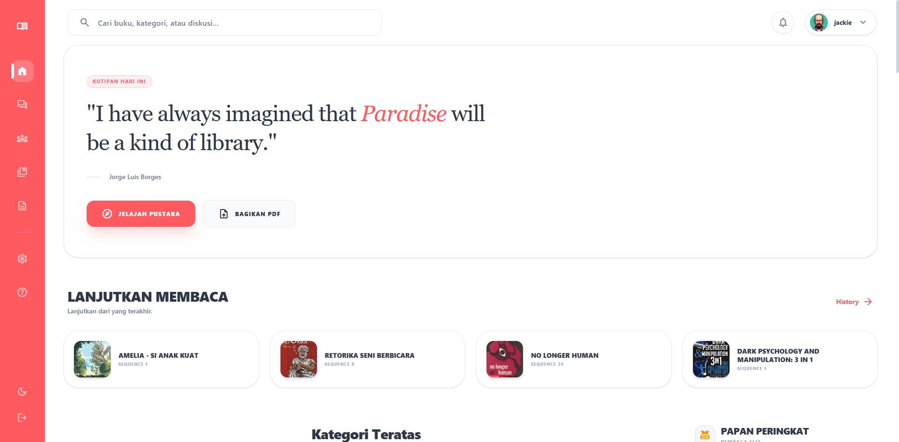
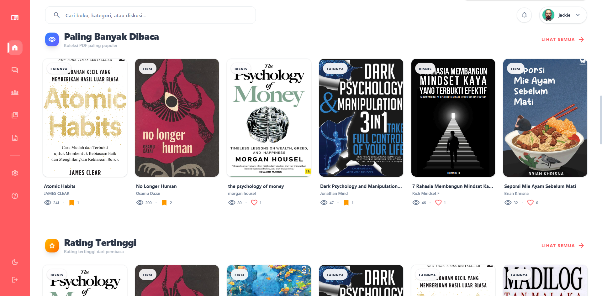
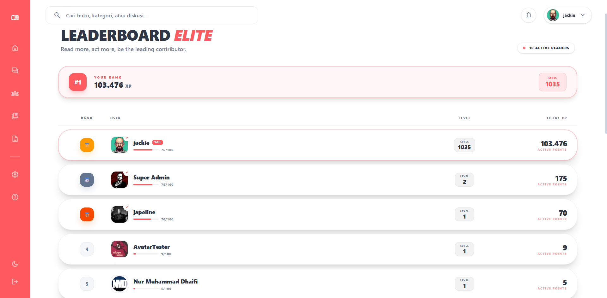

<div align="center">

# Book-In
### Your personal library. Reimagined.

**Baca lebih nyaman. Kelola koleksi lebih mudah. Temukan wawasan baru dengan AI.**

Perpustakaan digital untuk membaca, mengelola, dan menjelajahi dokumen PDF dalam satu pengalaman yang modern.

[**Jelajahi Repository**](https://github.com/Dzakiudin/Perpustakaan-PDF) · [Fitur](#-fitur-utama) · [Instalasi](#-menjalankan-secara-lokal) · [Teknologi](#-teknologi)

<br/>


<br/>


</div>

---

## Tentang Book-In

**Book-In** adalah aplikasi perpustakaan PDF digital yang menyatukan koleksi buku, pengalaman membaca, aktivitas komunitas, dan bantuan berbasis *Artificial Intelligence* (AI). Antarmuka dirancang agar pengguna dapat menemukan bacaan, menyimpan progres, dan mengelola koleksi dalam satu tempat.

> Bukan sekadar tempat menyimpan PDF — Book-In dirancang untuk membantu pengalaman membaca menjadi lebih terorganisir dan interaktif.

## ✨ Fitur utama

<table>
<tr>
<td width="50%" valign="top">

### 📚 Perpustakaan digital
Jelajahi koleksi buku, gunakan pencarian dan kategori, serta simpan buku yang ingin dibaca.

</td>
<td width="50%" valign="top">

### 📖 PDF reader
Baca dokumen PDF langsung dari aplikasi dengan dukungan tampilan dokumen berbasis `react-pdf`.

</td>
</tr>
<tr>
<td width="50%" valign="top">

### 🤖 Asisten AI
Integrasi OpenRouter API untuk mendukung pengalaman interaksi dan analisis dokumen berbasis AI sesuai konfigurasi aplikasi.

</td>
<td width="50%" valign="top">

### 🗂️ Koleksi dan progres
Kelola koleksi pribadi, penanda buku, riwayat membaca, serta anotasi yang tersimpan.

</td>
</tr>
<tr>
<td width="50%" valign="top">

### 💬 Komunitas pembaca
Forum diskusi, balasan, ulasan, dan interaksi antar pengguna untuk berbagi perspektif bacaan.

</td>
<td width="50%" valign="top">

### 🛡️ Pengelolaan pengguna
Fitur administrasi untuk membantu mengelola akun, buku, kategori, dan aktivitas komunitas.

</td>
</tr>
<tr>
<td width="50%" valign="top">

### 🔎 OCR
Dukungan Tesseract.js untuk ekstraksi teks dari gambar pada alur yang menggunakan fitur OCR.

</td>
<td width="50%" valign="top">

### 🎨 Pengalaman modern
Dukungan tata letak responsif serta tema gelap/terang untuk pengalaman lintas perangkat.

</td>
</tr>
</table>

## 🖼️ Pratinjau aplikasi

Lihat beberapa tampilan antarmuka Book-In:

<div align="center">
  
  
  <br/>
  
  
</div>

## 🧰 Teknologi

| Area | Teknologi |
| --- | --- |
| Framework | Next.js 16, React 19 |
| Bahasa | TypeScript |
| Antarmuka | Tailwind CSS 4, Framer Motion |
| Database | SQLite, Prisma ORM |
| Autentikasi | Jose, Bcryptjs |
| Pembaca PDF | React PDF, PDF.js |
| Editor | Tiptap |
| AI | OpenRouter API |
| OCR | Tesseract.js |
| Validasi | Zod |
| Pengujian | Vitest, Testing Library |

## 🚀 Menjalankan secara lokal

### Prasyarat

- Node.js dan npm
- Git

### 1. Klon repository

```bash
git clone https://github.com/Dzakiudin/Perpustakaan-PDF.git
cd Perpustakaan-PDF
```

### 2. Instal dependensi

```bash
npm install
```

### 3. Siapkan variabel lingkungan

Buat file `.env` di direktori utama proyek. Sesuaikan nilainya dengan kebutuhan aplikasi dan konfigurasi lokal.

```env
DATABASE_URL="file:./prisma/dev.db"
JWT_SECRET="ganti-dengan-secret-acak-yang-kuat"
OPENROUTER_API_KEY="isi-api-key-jika-fitur-AI-diperlukan"
```

**Penting:** jangan unggah file `.env` atau API key ke repository publik. Gunakan nilai rahasia yang kuat untuk lingkungan produksi.

### 4. Siapkan Prisma dan database

```bash
npx prisma generate
npx prisma db push
```

Jika skrip seed tersedia dan ingin menjalankannya:

```bash
npx prisma db seed
```

### 5. Jalankan server pengembangan

```bash
npm run dev
```

Buka [http://localhost:3000](http://localhost:3000) pada browser.

### Skrip yang tersedia

| Perintah | Kegunaan |
| --- | --- |
| `npm run dev` | Menjalankan server pengembangan |
| `npm run build` | Membuat build produksi |
| `npm run start` | Menjalankan build produksi |
| `npm run lint` | Memeriksa kualitas kode dengan ESLint |
| `npm test` | Menjalankan pengujian dengan Vitest |

## 📁 Struktur proyek

```text
Perpustakaan-PDF/
├── docs/          # Gambar promosi dan tangkapan layar
├── prisma/        # Skema dan konfigurasi database
├── public/        # Aset publik
├── src/
│   ├── app/       # Halaman dan endpoint aplikasi
│   ├── components/# Komponen antarmuka
│   ├── context/   # State dan konteks aplikasi
│   └── lib/       # Utilitas dan integrasi
├── .env           # Variabel lingkungan lokal (jangan commit)
└── package.json
```

> Struktur di atas merupakan ringkasan direktori utama. Isi aktual dapat berubah seiring pengembangan.

## 🔐 Catatan keamanan

- Atur `JWT_SECRET` dengan nilai acak dan rahasia sebelum deployment.
- Simpan `OPENROUTER_API_KEY` hanya di variabel lingkungan server.
- Jangan gunakan kredensial bawaan pada lingkungan publik.
- Jika endpoint seed atau pembuatan akun admin diaktifkan di lingkungan lokal, pastikan mekanismenya aman sebelum aplikasi dipublikasikan.
- Tinjau konfigurasi autentikasi, unggahan file, dan penyimpanan database sebelum menjalankan aplikasi di produksi.

## 🗺️ Pengembangan

Book-In terus dapat dikembangkan mengikuti kebutuhan pembaca dan pengelola perpustakaan. Saran, laporan masalah, dan kontribusi dapat disampaikan melalui [GitHub Issues](https://github.com/Dzakiudin/Perpustakaan-PDF/issues).

## 📄 Lisensi

Belum ada informasi lisensi yang dicantumkan di README ini. Periksa berkas lisensi repository atau tambahkan lisensi yang sesuai sebelum mendistribusikan atau menggunakan ulang proyek.

---

<div align="center">

**Book-In — Make every page count.**

Dibangun dengan ❤️ untuk pengalaman membaca digital yang lebih baik.

[Repository GitHub](https://github.com/Dzakiudin/Perpustakaan-PDF)

</div>
